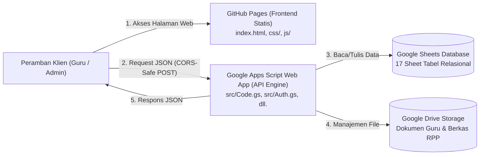

# ADMINISTRASI GURU SD (Arsitektur Terpisah: GitHub Pages & Google Apps Script)

Aplikasi web administrasi pembelajaran untuk guru Sekolah Dasar dengan arsitektur modern terpisah (**Decoupled Architecture**):
- **Frontend**: Single-Page Application (SPA) HTML5, CSS3, dan Vanilla JavaScript yang di-hosting langsung di **GitHub / GitHub Pages**.
- **Backend & API**: **Google Apps Script** Web App yang mengekspos endpoint RESTful JSON API via `doPost(e)` dan `doGet(e)`.
- **Database**: **Google Sheets** (17 sheet tabel relasional).
- **Penyimpanan Berkas**: **Google Drive**.
- **Sinkronisasi Kode Backend**: **Google clasp**.

---

## 1. Diagram Arsitektur Sistem



---

## 2. Struktur Proyek

```text
ADMINISTRASI_GURU_SD/
├── index.html             # Entry point Frontend (GitHub Pages)
├── css/
│   └── styles.css         # Desain antarmuka responsif & modern
├── js/
│   ├── config.js          # Pengaturan URL Google Apps Script Web App
│   ├── api.js             # Client HTTP fetch (CORS-Safe POST ke Apps Script)
│   └── app.js             # State SPA, router tampilan, modal, dan logika UI
│
├── src/                   # Backend Google Apps Script (dikelola via clasp)
│   ├── Code.gs            # API Gateway JSON (doGet & doPost router)
│   ├── Config.gs          # Konfigurasi nama sheet, durasi sesi, dan properti
│   ├── Database.gs        # Skema 17 sheet, fungsi setupDatabase(), dan CRUD
│   ├── Auth.gs            # Login SHA-256 + Salt, Session CacheService, Rate Limit
│   ├── Admin.gs           # Logika dashboard admin, kelola user, dan delegasi Fase 2
│   ├── Guru.gs            # Logika dashboard guru, isolasi kelas ajar, delegasi Fase 2
│   ├── Utils.gs           # Hashing, token UUID, format waktu, dan audit log
│   └── appsscript.json    # Manifes Apps Script (V8 runtime, zona Asia/Jakarta)
│
├── .clasp.json            # Konfigurasi clasp (rootDir diarahkan ke "./src")
├── .claspignore           # Mengabaikan frontend dari push clasp ke Apps Script
├── .gitignore             # Melindungi token (.clasprc.json), node_modules, dll.
└── README.md              # Panduan lengkap instalasi, integrasi, dan deployment
```

---

## 3. Langkah Demi Langkah: Menyiapkan Database & Backend Google Apps Script

### Langkah 1: Masuk ke Folder Proyek & Instal clasp
Buka terminal PowerShell pada komputer Anda:
```powershell
cd "C:\Users\freza\OneDrive\Videos\project"

# Pasang clasp secara global jika belum terpasang
npm install -g @google/clasp
```

### Langkah 2: Login clasp & Buat Proyek Apps Script
1. Pastikan fitur **Google Apps Script API** telah diaktifkan di:
   [https://script.google.com/home/usersettings](https://script.google.com/home/usersettings) (Ubah status menjadi **ON**).
2. Login ke akun Google Anda:
   ```powershell
   clasp login
   ```
3. Buat proyek Apps Script baru (backend otomatis mengarah ke folder `src`):
   ```powershell
   clasp create --title "API ADMINISTRASI GURU SD" --type webapp --rootDir ./src
   ```
   *(Perintah ini otomatis mengisi `scriptId` pada file `.clasp.json`).*

### Langkah 3: Unggah Kode Backend ke Google Apps Script
```powershell
clasp push
```

### Langkah 4: Inisialisasi Database Google Sheets
1. Buka proyek Apps Script di peramban:
   ```powershell
   clasp open
   ```
2. Pada editor Apps Script, buka file `Code.gs`.
3. Di bilah menu atas, pilih fungsi `initSystem` dari daftar fungsi, lalu klik tombol **Run (Jalankan)**.
4. Setujui permintaan izin akses Google Spreadsheet dan Drive saat pertama kali dijalankan.
5. Periksa jendela **Execution Log**:
   - Spreadsheet database baru bernama `DB_ADMINISTRASI_GURU_SD` akan dibuat otomatis dengan 17 sheet lengkap.
   - Akun default Admin dibuat:
     - **Username**: `admin`
     - **Password**: `AdminPassword123!`
   - ID Spreadsheet disimpan secara otomatis di **Project Settings > Script Properties** (`SPREADSHEET_ID`).

### Langkah 5: Deploy Web App Backend & Salin URL API
1. Pada editor Apps Script, klik tombol **Deploy (Terapkan) > New deployment (Penerapan baru)**.
2. Klik ikon roda gigi pada jenis deployment, pilih **Web app**.
3. Atur parameter deployment:
   - **Description**: `v1 API Backend Administrasi Guru SD`
   - **Execute as**: `Me (email Anda)` *(Sangat penting: agar backend dapat mengakses database)*
   - **Who has access**: `Anyone` *(Sangat penting: agar frontend GitHub dapat mengirimkan request)*
4. Klik **Deploy**.
5. Salin tautan **Web App URL** yang dihasilkan (contoh: `https://script.google.com/macros/s/AKfycbx.../exec`).

---

## 4. Langkah Demi Langkah: Menyiapkan Frontend di GitHub Pages

### Langkah 1: Konfigurasi URL API di Frontend
Buka file [`js/config.js`](file:///C:/Users/freza/OneDrive/Videos/project/js/config.js), lalu masukkan URL Web App yang Anda dapatkan dari Langkah 5 di atas:
```javascript
const APP_CONFIG = {
  APP_NAME: 'ADMINISTRASI GURU SD',
  VERSION: '1.0.0-frontend',

  // Tempelkan URL Web App Deployment Anda di sini:
  DEFAULT_API_URL: 'https://script.google.com/macros/s/AKfycbx.../exec',
  // ...
};
```
*(Catatan: Anda juga dapat memasukkan atau memperbarui URL Web App langsung melalui antarmuka web dengan mengklik tombol "⚙️ Atur URL Web App" di bagian atas halaman).*

### Langkah 2: Inisialisasi Git & Unggah ke GitHub
1. Buat repositori baru di [GitHub](https://github.com/new) bernama `administrasi-guru-sd`.
2. Di terminal komputer Anda:
```powershell
cd "C:\Users\freza\OneDrive\Videos\project"

git init
git add .
git commit -m "feat: inisialisasi frontend github pages dan backend apps script api"
git branch -M main
git remote add origin https://github.com/<username-github-anda>/administrasi-guru-sd.git
git push -u origin main
```

### Langkah 3: Aktifkan GitHub Pages (1-Klik)
1. Buka repositori Anda di GitHub melalui peramban: `https://github.com/<username>/administrasi-guru-sd`.
2. Masuk ke tab **Settings** > menu **Pages** di bilah kiri.
3. Pada bagian **Build and deployment > Source**, pilih **Deploy from a branch**.
4. Di bagian **Branch**, pilih `main` dan direktori `/ (root)`, lalu klik **Save**.
5. Tunggu sekitar 1 menit. GitHub Pages Anda akan aktif di alamat:
   ```text
   https://<username-github-anda>.github.io/administrasi-guru-sd/
   ```

---

## 5. Pengujian Fungsionalitas Sistem

1. Buka alamat GitHub Pages Anda di peramban.
2. Periksa banner atas: Pastikan status bertuliskan `🟢 Terhubung ke Apps Script`.
3. Masuk menggunakan akun administrator default:
   - **Username**: `admin`
   - **Password**: `AdminPassword123!`
4. Pastikan dashboard admin terbuka dan menampilkan 4 kartu metrik (Total Guru, Siswa, Kelas, Mapel) serta riwayat log aktivitas langsung dari Google Sheets.
5. Masuk ke menu **Manajemen Pengguna**, klik tombol **Tambah Pengguna Baru** untuk membuat akun Guru baru (contoh: `guru_budi`, password `GuruPassword123!`, peran `GURU`).
6. Klik **Keluar (Logout)**, kemudian login kembali menggunakan akun Guru yang baru saja dibuat.
7. Pastikan portal Guru memuat identitas guru, jadwal hari ini, dan daftar kelas binaan.
8. Klik menu bertanda `Fase 2` (seperti *Absensi Siswa* atau *Input Nilai*) untuk memastikan modal notifikasi tahap pengembangan tampil secara elegan.

---

## 6. Spesifikasi Keamanan & Penanganan CORS

### Cara Sistem Mengatasi CORS Google Apps Script
Google Apps Script Web App secara teknis tidak mendukung metode HTTP preflight `OPTIONS`. Jika frontend mengirimkan request dengan header `Content-Type: application/json`, browser akan memicu preflight `OPTIONS` yang berujung pada pesan kesalahan CORS.

Modul [`js/api.js`](file:///C:/Users/freza/OneDrive/Videos/project/js/api.js) memecahkan kendala ini secara elegan:
- Payload JSON dikirim dengan header `Content-Type: text/plain;charset=utf-8`.
- Ini diklasifikasikan sebagai *CORS-safelisted request*, sehingga browser **tidak mengirimkan** preflight `OPTIONS`.
- Backend Apps Script membaca isi `e.postData.contents` sebagai JSON murni dan merespons via `ContentService` dengan redirect 302 yang menyertakan header `Access-Control-Allow-Origin: *`.

### Protokol Keamanan Data
- **Password Hashing**: Kata sandi di-hash menggunakan SHA-256 + salt acak unik per pengguna. Password teks biasa dan salt tidak pernah diekspos ke klien.
- **Session Tokens**: Token sesi berumur 6 jam disimpan di `CacheService.getScriptCache()`.
- **Role-Based Access Control**: Setiap fungsi sensitif diverifikasi hak aksesnya di backend server Apps Script.
- **Rate Limiting**: Maksimal 5 kali kegagalan login per 15 menit per username untuk mencegah serangan brute force.
